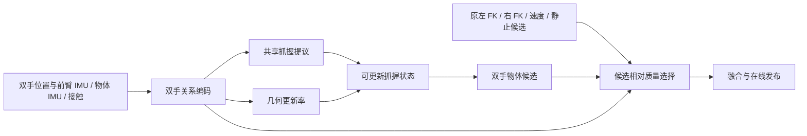

# 双手抓握分支与候选质量选择：OT 架构提案

日期：2026-09-14。状态：设计提案，未实现或训练。依据为 [五数据集双手诊断](bimanual_hoi_five_datasets_20260911.md)、当前 OT 实现及本文新增的只读缓存检查。

## 1. 首选方案与证据边界

建议在 OT-current 上增加一个**双手条件化的共享抓握预测分支**，并将**抓握几何更新速度**与**各候选的相对预测质量**分开建模。原有单手、速度、静止候选保留。

核心假设：双手关系能帮助选择较可靠的候选和更新抓握几何；一个直接学习“物体相对双手中点”的新预测分支，有机会修正左右单手分支共享的偏差。后半句尚未得到训练实验验证，不能从双手一致性推出。

不能承诺五集均大幅提升。现有证据对长序列上的候选选择更有利；OMOMO、PAHOI 若要明显超过几十分之一厘米，需要新分支实际预测出比原候选更好的共同偏移。

### 已测结论

- 固定物体和双手中点的理想差分修正，整集 HOI 只下降 0.52-1.26 cm；因果软约束只下降 0.09-0.24 cm。
- 硬锁定在四集明显有害，PAHOI 无明确收益。因此不能把双手关系或共享抓握向量设成段内硬常量。
- 当前 OT 已用一个 RNN 同时预测左右骨向量和融合权重，不是两个完全独立网络。仅“拼接左右手特征”不构成这里建议的架构改进。
- 已有 state_trust 无增广版本在对齐 checkpoint 后没有稳定长视野净收益。不能把这次方案重新做成“再加一个全局状态是否准确的 BCE 置信头”。

### 2026-09-14 新增只读检查

读取同一五集缓存，在 GT 双手帧上使用 GT 为每帧选择更低 HOI 的候选，其他帧保持基线。整集统计仍为序列等权的 GT 接触手-帧均值，且复现原基线到 1e-7 cm 内。

| 数据集 | 左右 FK 混合重选的局部 oracle 下降 (cm) | 四路单候选重选的局部 oracle 下降 (cm) | 单手骨预测误差中的共同能量占比 |
|---|---:|---:|---:|
| OMOMO | 0.5172 | 0.5383 | 66.52% |
| BEHAVE | 7.8934 | 7.8576 | 85.37% |
| IMHD | 1.8683 | 2.0592 | 80.44% |
| HODome | 4.4827 | 4.5313 | 86.88% |
| PAHOI | 0.6934 | 0.7265 | 69.09% |

定义与限制：

- 左右 FK 使用 refined 手修正后的 published 候选；在 0, 0.05, ..., 1 的 21 个左右混合权重和原 published 输出中选优。
- 四路单候选是左 FK、右 FK、基线上一帧 published 位置加原速度增量、基线上一帧 published 位置；仍包含原 published 输出作回退。它没有搜索所有四路连续混合，因此两列没有必然大小关系。
- 两种选择均使用 GT，且下一帧继续使用原基线历史。它们不是因果 rollout，也不是重训后收益或任意门控的严格上限。
- 共同能量占比为每条有双手帧序列上的 $\mathbb E\|\frac12(\epsilon_L+\epsilon_R)\|^2 / \mathbb E[\frac12(\|\epsilon_L\|^2+\|\epsilon_R\|^2)]$，再对序列平均；$\epsilon_h$ 是当前骨向量预测的世界系误差。不是 HOI 可回收百分比。

这些结果支持先验证双手条件化的候选选择，同时说明“让两个预测更一致”无法证明它们更准确。

共享抓握向量也不恒定：同一 GT 双手段内，物体系“中点到物心”向量相对段首的偏移，五集依次为 **7.35 / 11.15 / 10.20 / 12.14 / 5.54 cm**。对应单手骨向量偏移均值为 **8.79 / 14.81 / 16.61 / 15.76 / 6.04 cm**。共享表示有一定平均效应，但这不能证明它更容易从预测输入推断，更不能支持硬冻结。

## 2. 架构：一个新候选，两种不同的决策

### 2.1 双手关系编码

首版建议使用小型共享手编码器与因果 GRU，隐藏维度 64-128 作为容量起点；不需要大型 Transformer。输入包括：

- $v_t=R_{o,t}^{T}(\hat h_R-\hat h_L)$、其帧间变化、长度变化，以及相对最近可信抓握状态的变化。
- $R_{o,t}^{T}R_{forearm,h,t}$ 及其变化。前臂旋转由实际 IMU 恢复世界系，不从物体旋转推断腕旋转。
- 双手中点相对人体根节点的位置，表达在物体系；物体与身体 IMU 特征、预测接触概率及持续时间。
- 质量选择器另外接收左右 FK 提议分歧、各候选相对历史状态的创新量和物体静止证据。

手位置来自 HP 估计，不是精确观测。上述变化可能由真实几何变化或 HP 噪声造成，需要通过预测质量监督区分，不能直接阈值化为“发生滑移”。

共享抓握提议分支不输入递推的全局物体位置、由该位置重算的窗口初始骨向量，或由 published 历史计算的在线骨长统计。质量选择器可以使用这些状态信息。这样至少避免新提议直接复制原反馈中的共同漂移；并不等于获得了新的物理观测。

### 2.2 直接预测物体相对双手中点的向量

定义 $\hat h_M=(\hat h_L+\hat h_R)/2$。新分支预测物体系三维向量 $\tilde g_t$，而不是把原左右骨向量取平均：

$$
P_{B,t}=\hat h_{M,t}+R_{o,t}g_t.
$$

$P_B$ 是第五个候选。原来的 $P_L,P_R,P_I,P_S$ 保留；新候选可以位于原四路候选的凸包之外。

这里使用直接三维向量即可。双手中点可能靠近物心，此时“单位方向 + 长度”的方向参数化不稳定，也没有必要。

如果只是令 $g=(b_L+b_R)/2$，就退化成原左右 FK 的平均，不是新信息。新分支必须有自己的双手条件化预测路径和监督目标。

### 2.3 共享状态可更新，不冻结

一个足够小的首版更新形式为：

$$
g_t=(1-\alpha_t)g_{t-1}+\alpha_t\tilde g_t,\qquad 0<\alpha_t\leq1.
$$

$\alpha_t$ 由相对旋转、双手向量变化、提议与记忆的差等特征决定，表示“几何是否需要更新”。真实调整握法时允许快速更新；稳定且提议噪声大时允许慢更新。初始化使用当前抓握提议，不硬继承可能已漂移的全局物体位置。

不要对每次接触概率闪烁都强制硬重锚。使用连续接触证据管理有效状态；双手接触结束时降低该候选的可用性，再接触时允许重新初始化。

跨窗口回传已发布帧对应的 $g$ 和有效状态，不能每滑动一帧就重新初始化，也不能把 lookahead 末端状态写回已发布历史。可以复用已有 v3 段状态回传方式；首版无需改 HP 或增加未来帧。

### 2.4 候选质量与接触概率、几何更新率分开

质量头输出 $L/R/B/I/S$ 五个候选的相对效用。预测“手接触了”不等于预测“这只手的 FK 更准”，所以不能仅按接触概率配权重。

同样，$\alpha_t$ 大表示需要更新几何，不表示双手候选应该被降权。一次真实换握可以需要快速更新，同时仍应信任手侧候选。把这两个决策合并成一个置信量，会重复旧设计中的歧义。

在没有可靠双手接触证据时回退原 OT；在双手期间允许选左手、右手或共享候选，不能默认同时接触就各占一半。原融合保持可回退，适配层初始偏向基线，避免一开始全量替换已有行为。

几何变化大时不要机械地把 FK 权重移交速度或静止分支：先比较候选质量，静止分支还需运动状态证据。

## 3. 监督必须直接对应共同 HOI 误差

在 GT 双手接触帧上，以 canonical GT 掌根中点 $h_M^*$ 定义目标世界向量 $r_B^*=p^*-h_M^*$。使用：

$$
\mathcal L_B=\|R_o g_t-r_B^*\|,\qquad
\mathcal L_{proposal}=\|R_o\tilde g_t-r_B^*\|.
$$

这是关键：不要把目标换成 $p^*-\hat h_M$。后者会教新分支吸收人体中点的估计误差，可能改善绝对物体位置却损害相对 HOI。

对双手候选有精确关系：

$$
\frac{q_L+q_R}{2}
=\left(P_B-p^*\right)-\left(\hat h_M-h_M^*\right)
=R_o g_t-\left(p^*-h_M^*\right).
$$

因此 $\mathcal L_B$ 直接作用于此前诊断中的共同相对误差。双手几何本身并没有使目标可辨识；能否预测得更准，仍依赖训练数据中的抓握先验和 IMU/运动上下文。

保留原 published HOI、物体轨迹和运动平滑目标，不能只优化 $\mathcal L_B$。如需时间监督，匹配目标抓握向量的变化，而不是无条件惩罚变化趋近零；目标可用同一观测旋转写为 $g_t^*=R_{o,t}^{T}r_{B,t}^*$。

### 相对质量监督

对当前真实候选 $P_k$，用与最终发布一致的手位置构造：

$$
E_k=\frac{\sum_h c_h^*\| (P_k-\hat h_h)-(p^*-h_h^*)\|}{\sum_h c_h^*}.
$$

使用 $E_k$ 的排序或温度 softmax 分布作为质量头辅助目标，GT 仅在训练时用于标签。必须用两只接触手共同评价每个候选，不能拿“左候选对左手的误差”与“右候选对右手的误差”作不对称比较。

这比“全局状态误差是否小于 10 cm”的绝对阈值目标更贴近融合决策，但能否从部署特征辨认排序仍需验证。当所有候选都错误时，质量头不能创造正确位置；新抓握分支正是为了提供不同预测，而不是假设一致即正确。

## 4. 与已有实现的区别

| 已有设计 | 本提案的实质变化 |
|---|---|
| OT-current：共享 RNN 输出左右骨和四路权重 | 增加直接监督共同几何的双手候选，而非仅拼接双手特征 |
| v3：每只手的骨向量软锁存 | 双手共同目标、候选质量选择与几何更新率分离；不靠固定双手关系纠正 HP |
| state_trust：无状态左右先验 + 全局状态置信 | 不重做全局准确/错误分类；新分支预测共同向量，选择器学习候选相对效用 |
| 仅调整左/右权重 | 新双手候选有机会离开原候选凸包；这是更大短片段收益所需的新能力 |

主要接入点是 [ObjectTrans](../model/rnn/object_trans.py) 的 `_build_prediction_inputs`、`_decode_prediction_output`、`_predict_step`，以及 [损失](../train/rnn/loss/object_trans_loss.py) 的 HOI 监督区。在线状态和 publisher 都必须支持新候选；不能只改训练 forward 而让评测仍按旧四路重建输出。

## 5. 最小验证顺序与否证标准

1. **只做相对质量选择器**：冻结 HP、VC、OT 骨预测器，使用训练集的真实在线缓存训练小头。先看排序能否在独立验证集超过原门控，再做因果递推回放。GT 局部 oracle 有空间并不保证信号可识别。
2. **只加双手提议**：冻结上游，训练 $\tilde g$，暂不加状态记忆；在同一验证帧上对比原左右骨均值的共同误差。若新分支连这个对照都不优，停止增加记忆和复杂门控。
3. **加入可更新状态与五路选择**：保留相同训练预算，分别消融共享目标、相对质量监督、状态记忆。通过后再做完整在线 rollout 对齐微调。

训练使用预测输入，初始化与状态传播对齐部署；不以 GT 手、GT 接触作为推理输入。不要仅通过无结构初值噪声声称解决长视野问题。持久抓握状态要在跨窗口训练中真正经历上一窗口的预测。

用训练集划出的 subject/object 分组验证集调参和选择 checkpoint，不使用这五个测试集反复选最优；最终报告相同选择规则或 final、多种子结果。当前大误差含跨数据集偏移，加入新数据集训练必须另设同数据基线。

## 6. 对“大收益”的具体判断

- 最有证据的先行机会在 BEHAVE、HODome 的相对候选选择；IMHD 次之，样本数仅 15 条，方差较大。
- OMOMO、PAHOI 的当前候选局部重选只有约 0.52/0.69 cm 改善，不能据此期待单靠门控稳定获得多厘米收益。若要求较大提升，共同抓握预测分支必须通过第 2 步验证。
- 可把“长序列降低数厘米、OMOMO 不明显退化、物体误差和 jitter 不被牺牲”设为立项门槛；这是实验目标，不是已有结果或收益预测。
- 不支持直接引用任意物体平移 oracle 的 10-26 cm 作为预计收益，也不支持把已有 state_trust 的跨 checkpoint 差距归因于双手架构。

推荐先实现约束最少、可否证的小头和新候选。若候选排序不可预测、共同向量也无法优于基线，则现有输入下的双手结构未带来足够信息，应停止堆叠 OT 模块；更大的收益可能需要新的几何观测、数据覆盖或人体估计改进。